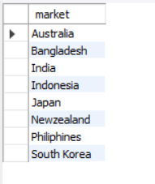

# AtliQ Hardware SQL Data Analysis

## Project Overview

This project analyzes AtliQ Hardware's sales and product data using
**MySQL**. It addresses 10 business questions covering market presence,
product performance, manufacturing costs, customer discounts, sales
trends, and sales-channel contribution.

The goal is to demonstrate practical SQL skills and translate query
results into clear business insights.

## Business Questions

1.  Identify the markets in the APAC region where AtliQ Exclusive
    operates.
2.  Calculate the year-over-year change in the number of unique
    products.
3.  Identify the number of unique products in each product segment.
4.  Analyze product-count changes by segment between FY2020 and FY2021.
5.  Identify products with the highest and lowest manufacturing costs.
6.  Find the top five customers in India with the highest average
    pre-invoice discount in FY2021.
7.  Calculate monthly gross sales for AtliQ Exclusive.
8.  Calculate total sold quantity by fiscal quarter for FY2020.
9.  Calculate gross sales by sales channel and each channel's
    contribution in FY2021.
10. Identify the top products in each division based on sold quantity in
    FY2021.

## Tools and Technologies

-   **Database:** MySQL
-   **SQL Environment:** MySQL Workbench
-   **Version Control:** Git and GitHub

## SQL Concepts Demonstrated

-   SELECT, WHERE, ORDER BY, GROUP BY
-   DISTINCT and aggregate functions
-   JOINs
-   CASE WHEN
-   Common Table Expressions (CTEs)
-   Subqueries and UNION ALL
-   Window functions
-   DENSE_RANK() and PARTITION BY
-   Percentage and year-over-year calculations

## Repository Structure

``` text
atliq-hardware-sql-data-analysis/
├── sql/
│   └── atliq_hardware_analysis.sql
├── results/
│   ├── q1_apac_markets.png
│   ├── q5_manufacturing_cost.png
│   ├── q8_quarterly_sales.png
│   ├── q9_sales_by_channel.png
│   └── q10_top_products.png
└── README.md
```

The screenshot filenames above are suggested names. Keep only files you
have actually uploaded, and update this list to match your repository.

## Business Insights and Findings

The findings below are based on query outputs previously recorded during
the project. Re-run the queries against your database before treating
these figures as final.

### 1. APAC Market Presence

AtliQ Exclusive operates in **8 APAC markets**:

-   India
-   Indonesia
-   Japan
-   Philippines
-   South Korea
-   Australia
-   New Zealand
-   Bangladesh

**Business insight:** AtliQ Exclusive has a presence across eight
markets in the Asia-Pacific region. This provides a regional footprint
for understanding market-specific customer requirements and
opportunities.



### 2. Manufacturing Cost Analysis

  Category       Product                 Product Code     Manufacturing Cost
  -------------- ----------------------- -------------- --------------------
  Highest cost   AQ HOME Allin1 Gen 2    A6120110206                240.5364
  Lowest cost    AQ Master wired x1 Ms   A2118150101                  0.8920

**Business insight:** Manufacturing costs vary considerably across the
product portfolio. Identifying the highest- and lowest-cost products can
support further pricing, margin, and cost-control analysis.


### 3. Quarterly Sales Quantity - FY2020

  Fiscal Quarter     Sold Quantity
  ---------------- ---------------
  Q1                     7,005,619
  Q2                     6,649,642
  Q3                     2,075,087
  Q4                     5,042,541

**Business insight:** - Q1 recorded the highest sales quantity, with
7,005,619 units. - Q3 recorded the lowest sales quantity, with 2,075,087
units. - Sales quantity varied considerably across the fiscal year.

Management could investigate the factors behind the Q3 decline and
consider quarterly demand patterns when planning inventory and sales
activities.


### 4. Gross Sales by Channel - FY2021

  Sales Channel     Gross Sales (Million)   Contribution
  --------------- ----------------------- --------------
  Retailer                       1,219.08         73.23%
  Direct                           257.53         15.47%
  Distributor                      188.03         11.30%
  **Total**                  **1,664.64**    **100.00%**

**Business insight:** The Retailer channel contributed the largest share
of FY2021 gross sales at **73.23%**. Direct sales contributed 15.47%,
while Distributor sales contributed 11.30%.

This indicates that the Retailer channel was the dominant sales channel
in the recorded results. The company could maintain retailer
relationships while exploring opportunities to grow the other channels.


### 5. Top-Selling Products by Division - FY2021

The following leading products were recorded in the shared query
results:

  Division   Product Code     Sold Quantity
  ---------- -------------- ---------------
  N & S      A6720160103            701,373
  P & A      A2319150302            428,498
  PC         A4218110202             17,434

**Business insight:** These results identify leading products in the
listed divisions by sold quantity. Such information can help inform
inventory planning and product-level sales strategies.

**Note:** These are selected leading products from the previously shared
output, not a complete top-three list for every division. The query uses
`DENSE_RANK()`, which can return more than three rows per division when
products share a rank.


## Project Files

-   `sql/atliq_hardware_analysis.sql` - SQL queries used to answer the
    10 business questions.
-   `results/` - Screenshots of selected query outputs.

## How to Use This Project

1.  Clone or download this repository.
2.  Open MySQL Workbench and connect to your MySQL instance.
3.  Make sure the AtliQ Hardware database and required tables are
    available.
4.  Open `sql/atliq_hardware_analysis.sql`.
5.  Execute the queries individually and review the result grids.

## Validation Notes

-   The findings in this README reflect outputs previously recorded
    during the project. Re-run the SQL queries to verify them against
    the current database.
-   Product-count results can differ depending on whether the analysis
    counts products represented in `fact_sales_monthly` or
    `fact_gross_price`. Confirm the intended definition for Questions 2
    and 4 against the original challenge before publishing those
    figures.
-   The Question 10 table shows selected leading products from the
    previously shared output. It is not a complete top-three list for
    all divisions.
-   Gross sales figures are presented in millions as recorded in the
    project results.

## Conclusion

This project demonstrates how SQL can be used to answer practical
business questions from sales and product data. It covers data
retrieval, aggregation, joins, fiscal-period analysis, ranking, and
window functions, while connecting query outputs to business
observations.

## Author

**Jay**

GitHub: [@jaychamare](https://github.com/jaychamare)
